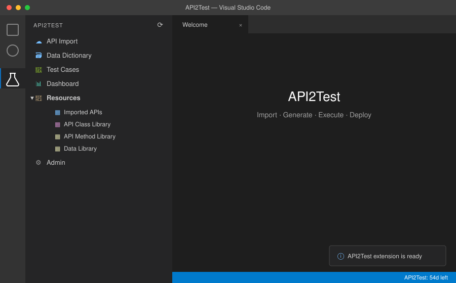
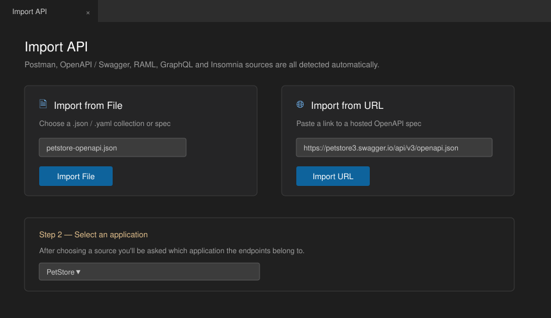
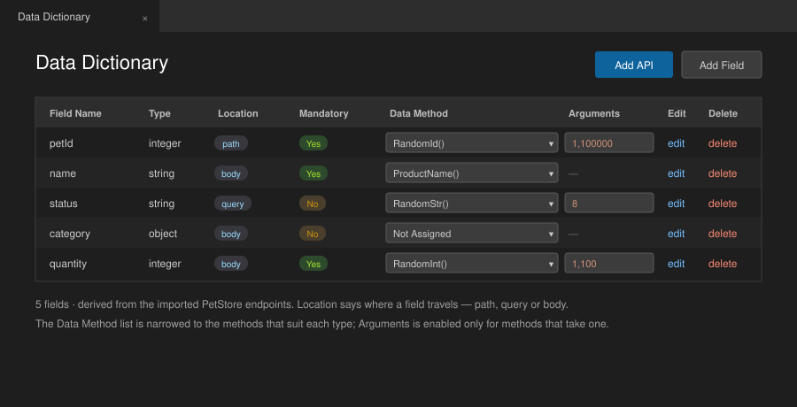
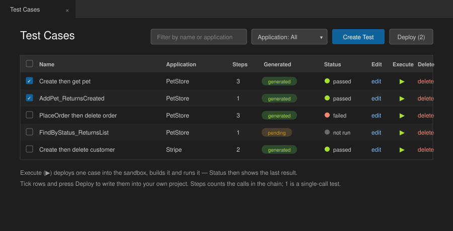

# API2Test for VS Code — Quick Start

API2Test turns an API specification into **runnable integration tests**, generated in the language
you choose — **C#, TypeScript or Python** — all inside VS Code.

This guide gets you from install to your first executed test in a few minutes.

> **Version:** `Api2Test.vsix` in this pack is extension version **0.2.62**. The filename stays
> the same in every refresh, so the install command below never changes.
>
> The figures below illustrate the API2Test UI. Your colours will match your active VS Code theme.

---

## 1. Install

**From the bundled package**

This repo ships the extension as [`Api2Test.vsix`](Api2Test.vsix).

```bash
code --install-extension Api2Test.vsix
```

Or in VS Code: open the Extensions view (`Ctrl+Shift+X`) → `…` menu →
**Install from VSIX…** → pick the `.vsix`, then reload.

> **Upgrading from an earlier trial build?** Uninstall the previous version first, then install this
> one and reload, so you're certain the latest UI is running. Your data is kept either way.

See [`InstallationGuide.pdf`](InstallationGuide.pdf) for step-by-step install instructions with
prerequisites.

**Your 60-day trial starts now.** Installing unlocks **everything** — there are no feature tiers.
**Admin → Licence** shows the countdown ("Trial — 54 days left"), and so does a compact
`API2Test: 54d left` in the status bar, bottom-right. When the trial ends every command asks for a
licence key; one key unlocks both VS Code and the Desktop app.

---

## 2. First run — pick your language, then the sandbox

On first activation API2Test asks **which language generated tests should target** — C#, TypeScript
or Python. Two things make the rest easy to place:

- **Generating code needs nothing installed.** Import, the libraries, Generate Class and
  Generate & Save all work immediately.
- **Executing that code does.** **Execute** copies the test, its classes and the libraries into the
  **sandbox** and runs them with your language's real toolchain.

The choice is made **once and locked** — the curated libraries are seeded in that language and the
sandbox is scaffolded for it. It is shown in **Admin**.

**The sandbox** is a folder you map once (on first run, or later in **Admin → Sandbox**; the default
offered is `%APPDATA%\Api2Test\sandbox`). It is deliberately **not** your open workspace — it keeps
API2Test's test project apart from your application's source. Inside it the extension scaffolds a
ready-to-run project in a subfolder named after your language.

### What you need installed (only for your chosen language)

| Language | Toolchain (machine-wide, on PATH) | VS Code extension | Test framework + libraries |
|---|---|---|---|
| **C#** (default) | .NET SDK — `dotnet` | C# Dev Kit (`ms-dotnettools.csdevkit`) | MSTest + Bogus, already in the scaffolded `ApiTests.csproj` — NuGet restores them on the first build |
| **TypeScript** | Node.js LTS + npm | Vitest (`vitest.explorer`) | `npm install` once in the sandbox's `typescript` folder (vitest, typescript, @faker-js/faker) |
| **Python** | Python 3 + pip (tick *Add python.exe to PATH*) | Python (`ms-python.python`) | `pip install -r requirements.txt` once in the sandbox's `python` folder (pytest, requests, Faker) |

**Requirements are checked live, on every launch.** First run checks every requirement for your
language as a ✓/✗ row, with the exact remedy on each ✗. The page **reopens on every VS Code launch
until every row is ✓**, so a half-finished install can't go quiet. Reopen it any time with
**API2Test: Show Environment Requirements** (Command Palette); **Re-check** re-probes after you
install something.

---

## 3. Open the API2Test panel

Click the **flask icon** (🧪) in the Activity Bar on the left edge of VS Code.
The **API2Test** tree view follows the workflow top to bottom.



| Entry | What it does |
|-------|--------------|
| **API Import** | Import a Postman collection or OpenAPI/Swagger spec |
| **Data Dictionary** | Define the fields your tests use, and the data method behind each |
| **Test Cases** | Build, generate, execute and deploy test cases |
| **Dashboard** | Your recent executions, with a full report per run |
| **Resources** | Imported APIs, API Class Library, API Method Library, Data Library |
| **Admin** | Applications, the locked language, Sandbox, Deploy Paths, Licence |

> Tip: use the **Refresh** button (top of the panel) any time the tree looks stale.

---

## 4. Import an API

Click **API Import**. The import dialog opens with two options:

- **From File** — a `.json` Postman collection or an OpenAPI/Swagger (`.json` / `.yaml`) file.
  RAML, GraphQL and Insomnia workspaces import too.
- **From URL** — paste a link to a hosted spec.



The format is detected automatically. You'll be prompted to pick (or create) the **Application** the
endpoints belong to — everything downstream is grouped by application, so many APIs can live side by
side.

Try it with the samples in [`Example Swagger Files`](Example%20Swagger%20Files) —
e.g. `petstore-openapi.json` or the Postman collections included there.

**Or import straight from a public URL.** Pick **From URL** and paste one of these live, free specs
(no API key needed):

| API | Spec URL |
|-----|----------|
| Swagger PetStore (OpenAPI 3.0) | `https://petstore3.swagger.io/api/v3/openapi.json` |
| Swagger PetStore (Swagger 2.0) | `https://petstore.swagger.io/v2/swagger.json` |
| APIs.guru Directory (OpenAPI 3.0) | `https://api.apis.guru/v2/specs/apis.guru/2.2.0/openapi.json` |

Verify the result under **Resources → Imported APIs**, which lists every imported endpoint. A search
box and a **Method** dropdown narrow large specs — handy on something like Stripe, which imports
~589 endpoints.

---

## 5. Generate request classes

The quickest route is the batch one. On **Resources → Imported APIs**:

1. **Tick** the endpoints you want classes for (filter first to narrow the list).
2. Press **Generate Class**.

For each ticked endpoint API2Test imports its fields into the **Data Dictionary** (duplicates
skipped, data methods auto-matched), creates the **class entry**, and generates the request class.
A summary reports the tally: **generated**, **pending** (usually a mandatory field with no data
method yet), or **failed**.

Per-endpoint instead? Add it to the Data Dictionary, then use **Update & Generate** on its row in
**Resources → API Class Library** — which re-reads the endpoint and the current Data Dictionary
first, then generates the class into an editable preview.

---

## 6. Review the Data Dictionary

Click **Data Dictionary** to open its table. Each row is a field your tests use — **Field Name,
Type, Location** (body/path/query), **Mandatory**, and the **Data Method** that supplies its value.



- Change a field's **Data Method** from the dropdown at any time. The list is narrowed to methods
  that fit the field's type (an `object` field offers object methods), with **Show all** to override.
- **Edit Field** (the pencil) shows a **Structure** block for an `object` or `array` field, read from
  the endpoint — it tells you what shape a data method for that field has to return.
- **Data method arguments** are emitted verbatim: `DateStr` with `-3` becomes `DateStr(-3)`.
- A field left **Not Assigned** is simply omitted from the request (fine for optional fields).

A field with no data method is the usual reason a class comes back **pending** — assign one, then
**Update & Generate** the class.

---

## 7. Build a test case — one call, or an E2E chain

Click **Test Cases**, then **Create Test**. The same builder covers a one-call smoke test and a
multi-step **E2E chain** — you just add more steps.



**The test's settings:** a **Name**, the **Application**, the **Framework** (MSTest for C#, Vitest
for TypeScript, pytest for Python), a **Base path method** for the base URL (e.g. `PetStoreBaseUrl`)
and a **Token method** for auth — leave the placeholder for the public Petstore, which needs none.

**Adding steps:** **Add class…** adds an API call step (listed as `ClassName — VERB /path`);
**Add method…** adds a standalone API Method Library step. Steps run top to bottom; **↑ ↓** reorder
and **✕** removes.

**A class step's header tells you the whole call:**

```
AddPet → PostJson → ValidateSuccess_200_201
PlaceOrder → PostJson → ExtractFields (id → orderId)
```

That is the class, the **send method** (picked from the verb and content-type), and the response
handling — a **validator** matched to the verb when you capture nothing, or the **extract** method
when you do. None of it is wired by hand.

Open a step for three groups:

- **IN — path parameters.** A row per `{placeholder}`. Type a literal, or tick **var** and name a
  variable captured by an earlier step. This is how a chain works.
- **IN — pinned body fields.** Every body field is filled by its data method by default. Pin one to
  override it for this test — a literal (the way to write a negative test) or a captured variable.
- **OUT — output parameters.** **+ output param** captures a value from the response: pick the
  response field (listed with its type, e.g. `id (integer)`), name the variable, and pick **store
  as** — the type it is held as, in your language's own types. **This is required**; Generate & Save
  tells you which captures still need one.

**A worked PetStore chain:**

1. **AddPet** — POST, no captures → header ends `ValidateSuccess_200_201`.
2. **PlaceOrder** — POST; **+ output param**: `id (integer)` → variable `orderId`, store as `long`.
3. **DeleteOrder** — DELETE `/store/order/{orderId}`; in the path parameter row tick **var** and
   enter `orderId` → header ends `ValidateDeleted_200_204`.

**Generate & Save** generates the code for the whole chain and saves the case with it. If anything
blocks generation — a capture without a type, an unresolved mandatory value — the reason is shown at
the button and nothing is saved until it is fixed. **Edit** reopens the builder exactly as you left
it.

A complete worked output is in [`Example Generated Project`](Example%20Generated%20Project).

---

## 8. Execute it

On the Test Cases table, press **Execute** (▶) on a row. Execute:

1. **deploys** the case to the sandbox — the test, its classes, both libraries — so it always runs
   what you last saved;
2. **builds** the sandbox project (a compile error is reported as the result, with compiler output);
3. **runs** the test and reports the real outcome — pass or fail, with the API calls it made. A run
   where nothing executed is reported as a failure, never silence.

**Dashboard** (sidebar, or **API2Test: View Dashboard**) lists your recent executions: summary cards
(runs, tests executed, pass rate, failures) and a row per run with outcome, duration and the first
line of any failure. Click **report** in a row to open the full run report — the complete **API call
chain**, every request and response with bodies and status codes.

From a terminal, in the sandbox or a deployed project:

```bash
dotnet test --filter "FullyQualifiedName~<TestClassName>"
```

TypeScript: `npx vitest run <TestFileName>`. Python: `python -m pytest Tests/<App>/test_<name>.py`.

---

## 9. Deploy into your own project (optional)

**Execute** runs in the sandbox; **Deploy** is the handoff to your repo.

1. Add your test project's folder in **Admin → Deploy Paths**.
2. On Test Cases, **tick** the cases, press **Deploy**, pick the path, and choose whether to include
   the libraries (`DataGenerator` + `ApiMethods` — tick it the first time, or after changing a
   library method).

A test case travels as a **complete unit** — the test plus every class its steps use — because a test
on its own does not compile. Files land in the folder their namespace dictates:

```
<your project>/
├─ Libraries/      DataGenerator.*  ApiMethods.*   # Api2Test.Generated.Libraries
├─ Classes/<App>/                                  # Api2Test.Generated.Classes.<App>
└─ Tests/<App>/                                    # Api2Test.Generated.Tests.<App>
```

Deploy is a one-way handoff: the case is **moved** out of the sandbox and the tool never touches that
folder again — the repo is yours to control.

---

## Where your data lives

All API2Test data is stored as JSON on your machine at:

```
~/.vscode/API2Test/data/
```

(on Windows: `C:\Users\<you>\.vscode\API2Test\data\`)

It is **never overwritten by an upgrade**. Built-in Data Library / API Method Library methods are
merged in on activation, keeping your own methods and renames. Delete that folder to reset to the
shipped defaults.

---

## Typical workflow at a glance

```
API Import → Imported APIs (Generate Class) → Data Dictionary → Test Cases (build)
          → Execute → Dashboard → Deploy
```

---

## What's in this repo

| Item | Description |
|------|-------------|
| [`Api2Test.vsix`](Api2Test.vsix) | The installable VS Code extension |
| [`InstallationGuide.pdf`](InstallationGuide.pdf) | Install steps and prerequisites |
| [`QuickStartGuide.pdf`](QuickStartGuide.pdf) | This guide, as a printable PDF |
| [`Example Swagger Files`](Example%20Swagger%20Files) | Sample specs/collections to import |
| [`Example Generated Project`](Example%20Generated%20Project) | A worked test project |
| [`Feedback Questionnaire.pdf`](Feedback%20Questionnaire.pdf) | Tell us how the trial went |

---

## Troubleshooting

- **The requirements page keeps opening on launch** — something for your language is still ✗. Follow
  the hint on the missing row, press **Re-check**; once every row is ✓ it stops appearing.
- **Tree is empty after import** — click **Refresh** at the top of the panel.
- **Import from URL fails** — make sure the URL returns the raw spec (JSON/YAML), not an HTML page;
  API2Test rejects responses that start with an HTML tag.
- **A class row is red** — the last generation failed. Open **Edit** to read the error (usually an
  unassigned mandatory field), fix it, then **Update & Generate**.
- **"Not Assigned" data method** — the field has no generator yet; pick one, or add a method to the
  Data Library, then **Update & Generate** the class.
- **Generate & Save is blocked** — read the message at the button: most often an OUT capture is
  missing its **store as** type.
- **Execute fails to build** — the compiler output is the result; it is usually a missing toolchain
  piece the requirements page can confirm.
- **Extension didn't activate** — check **Output → API2Test** (or `Help → Toggle Developer Tools`)
  for the activation log.
- **Reset everything** — close VS Code, delete `~/.vscode/API2Test/data/`, reopen.

---

When you've finished trying API2Test, we'd love your feedback —
please fill in [`Feedback Questionnaire.pdf`](Feedback%20Questionnaire.pdf).
